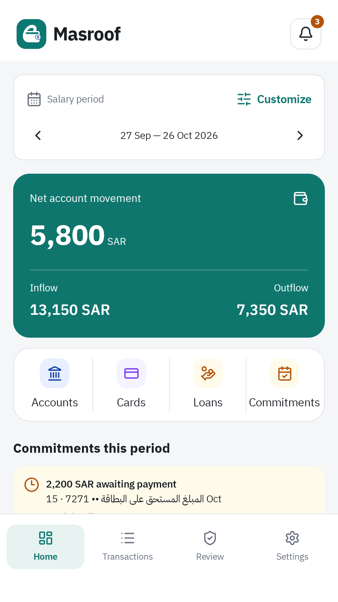
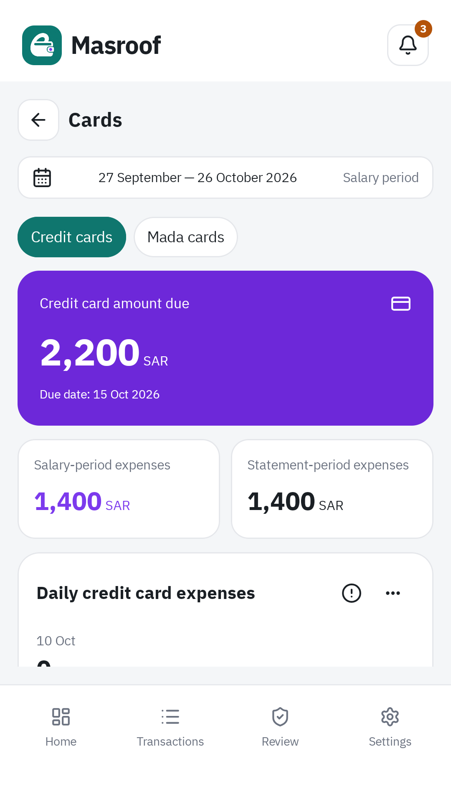
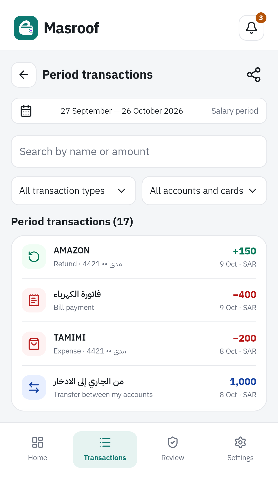
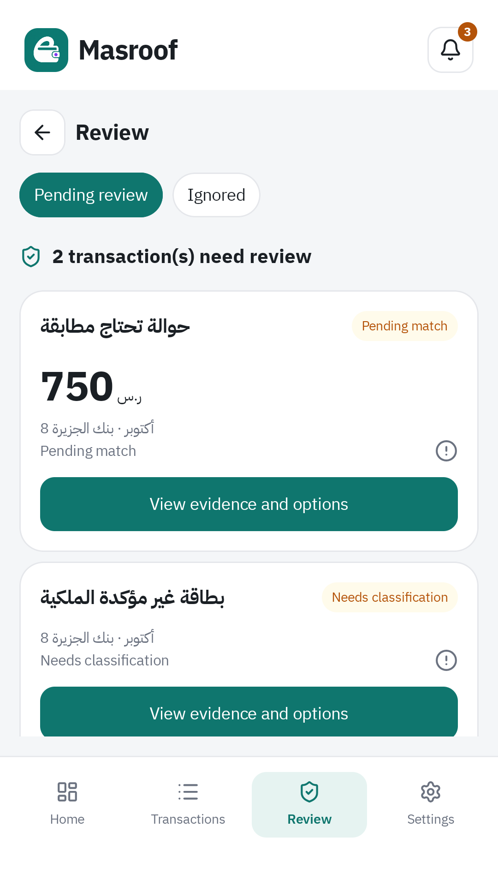

<p align="center">
  
</p>

<h1 align="center">Masroof · مصروف</h1>
<p align="center">Your bank messages. Your financial picture. On your phone.</p>
<p align="center"><a href="README_AR.md">العربية</a> · <a href="https://github.com/bakhshb/masroof/releases">Download APK</a> · <a href="docs/ARCHITECTURE.md">Developer docs</a></p>
<p align="center"><a href="https://github.com/bakhshb/masroof/actions/workflows/ci.yml"></a></p>

Masroof is a local-first Android personal finance app. It turns supported bank SMS into account and card summaries, a searchable transaction history, commitments, and spending insights. Messages that need a decision stay in a review inbox.

## A look inside

| Your salary period | Accounts and cards |
| --- | --- |
|  |  |
| **Search your transactions** | **Review uncertain messages** |
|  |  |

These are production screens captured with synthetic financial data. Arabic/RTL, English, and light/dark/system appearance are supported.

## Get started

1. Download an APK from [Releases](https://github.com/bakhshb/masroof/releases) and install it on Android 8.0 or later.
2. Select your banks and the receipt-date range you want to import. Grant SMS access when prompted.
3. Confirm ownership of your accounts and cards, configure card types, and review uncertain messages.
4. Explore your salary-period dashboard. New supported bank messages enter the same durable processing and review flow.

The app includes an update checker. Choose stable or nightly releases in Settings; nightly builds are prereleases. Export a password-protected backup before moving to another device.

## What you can do

- **Understand your cash flow:** salary-period inflow, outflow, spending, and account balances.
- **Track cards and commitments:** debit spending, shared credit-facility dues, loans, and recurring payments.
- **Find the evidence:** transaction search, filters, SMS details, and a review inbox with explicit corrections.
- **Choose what to import:** bank-scoped historical SMS import with inclusive receipt dates, duplicate protection, and retry recovery.
- **Teach message patterns:** review extracted fields and explicitly approve financial patterns before applying them.
- **Explore spending:** historical spending, purchase forecasts, recurring-payment suggestions, and optional phone alerts.
- **Keep a backup:** encrypted export and recovery, including settings, analysis, and message patterns.

Forecasts and suggestions are advisory. Local learning can assist eligible message families, but never supplies money, ownership, or posting approval. Statistical models remain disabled when their qualification requirements are not met; rules and consistent explicit human templates remain available.

## Bank support

| Bank or catalog entry | Current status |
| --- | --- |
| Bank AlJazira | Bundled role definitions and fixture-tested interpretation |
| STC Bank | Six bundled templates; explicit financial approval is required |
| Other configured banks | Catalog visibility is not automatic parsing support; teach and approve suitable patterns in Settings |

A bank name in the catalog does not guarantee every message format is supported. Unknown, suspected, and ambiguous messages remain reviewable. Account/card ownership is always a separate decision.

## Privacy and data

Financial records and SMS evidence are stored locally. Automatic Android cloud backup is disabled. Existing exchange-rate and app-update features use the network; the app is not entirely offline. Exported backups are protected by a passphrase.

Updates preserve the production financial database at **schema v18**. Other financial database/backup schemas are rejected without destructive fallback. Model and engine refreshes preserve posted history and manual decisions. See [architecture and recovery](docs/ARCHITECTURE.md) for the storage contracts.

## Build and contribute

Install JDK 27 for Gradle, JDK 21 for compilation/Android unit tests, and Android SDK 37 with Build Tools 37.0.0. Set `sdk.dir` in your local, untracked `local.properties` file.

```bash
./gradlew :app:assembleDebug
./gradlew :app:testDebugUnitTest --tests '*MessagePatternsWorkflowTest'
./gradlew lintDebug detekt
```

Pure JVM modules use JUnit Jupiter; Android/Robolectric tests retain their Android-compatible runner. Run focused tests locally. Full unit suites, model reproducibility, APK builds, device shards, and process-death recovery run in PR/main CI. Release publication checks successful CI for the exact commit before building the APK.

| Module | Responsibility |
| --- | --- |
| `app` | Android UI, workflows, SMS intake, persistence, and recovery |
| `bank-engine` | Pure bank-pattern interpretation and extraction evidence |
| `finance-core` | Money, periods, identities, financial classification, matching, and assembly |
| `ml-assist` | Local family assistance, forecasting, and recurrence detection |
| `ui-kit` | Shared theme, fonts, components, and charts |

Read the [architecture](docs/ARCHITECTURE.md), [testing and CI](docs/CI.md), [release workflow](docs/RELEASE.md), [design system](docs/DESIGN_SYSTEM.md), [analytics](docs/ANALYTICS.md), [learning tools](ml-assist/tools/README.md), and [agent conventions](AGENTS.md) before changing financial behavior. The [modernization record](docs/MODERNIZATION.md) documents version choices and compatibility verification.
