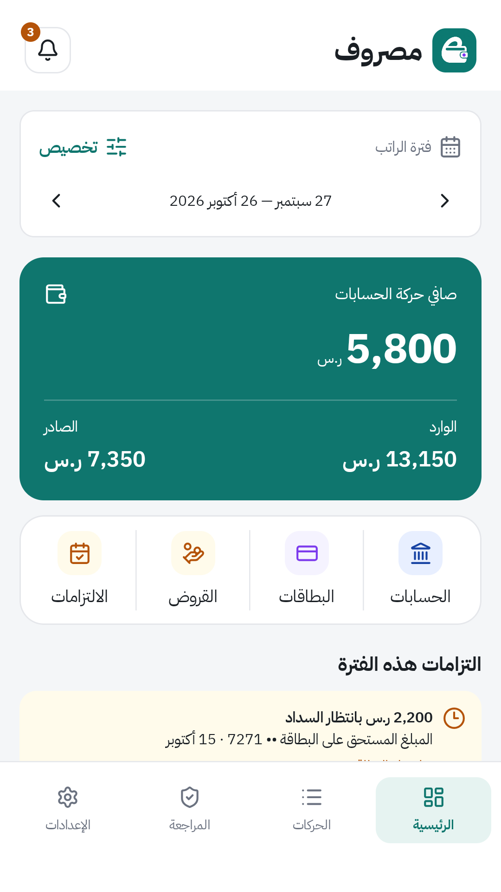
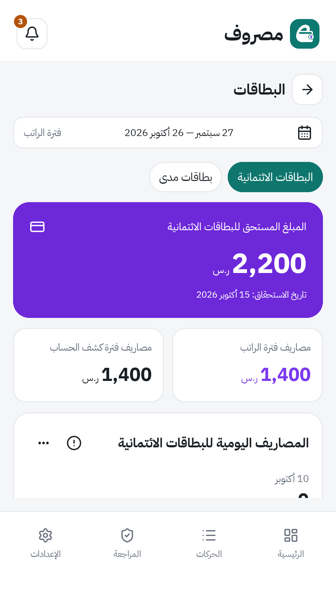
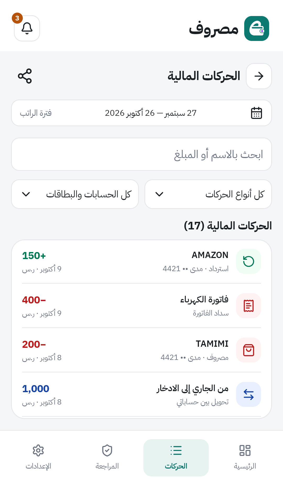
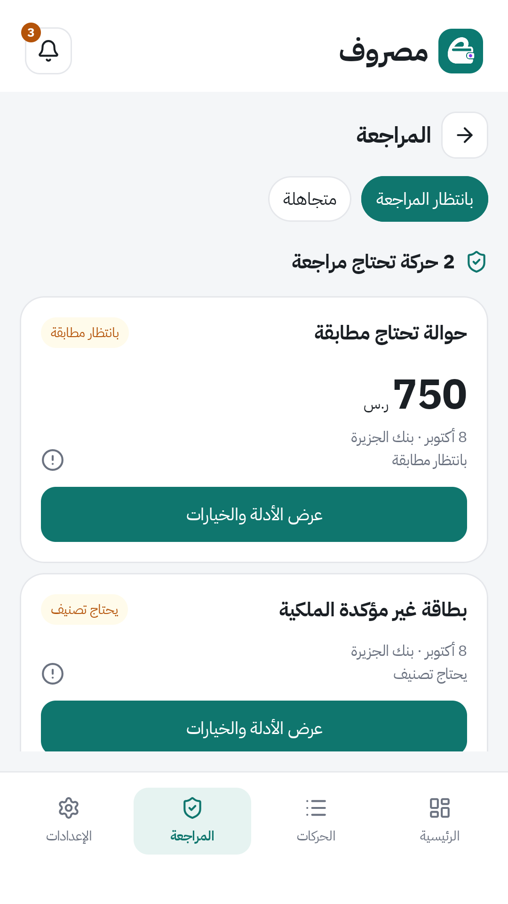

<p align="center">
  
</p>

<h1 align="center">مصروف · Masroof</h1>
<p align="center" dir="rtl">رسائل بنكك، وصورة أوضح لأموالك، على هاتفك.</p>
<p align="center"><a href="README.md">English</a> · <a href="https://github.com/bakhshb/masroof/releases">تحميل APK</a> · <a href="docs/ARCHITECTURE.md">توثيق المطورين</a></p>
<p align="center"><a href="https://github.com/bakhshb/masroof/actions/workflows/ci.yml"></a></p>

مصروف تطبيق Android لإدارة المال محليًا. يحوّل رسائل البنوك المدعومة إلى ملخصات للحسابات والبطاقات، وسجل حركات قابل للبحث، والتزامات، ومعلومات عن الصرف. وتبقى الرسائل التي تحتاج قرارًا منك في صندوق المراجعة.

## من داخل التطبيق

| دورة راتبك | الحسابات والبطاقات |
| --- | --- |
|  |  |
| **ابحث في حركاتك** | **راجع الرسائل غير المحسومة** |
|  |  |

هذه لقطات من واجهات التطبيق الفعلية ببيانات مالية تجريبية. يدعم التطبيق العربية واتجاه اليمين إلى اليسار، والإنجليزية، والمظهر الفاتح والداكن ومظهر النظام.

## ابدأ الاستخدام

1. حمّل ملف APK من [الإصدارات](https://github.com/bakhshb/masroof/releases) وثبّته على Android 8.0 أو أحدث.
2. اختر البنوك وفترة استلام الرسائل التي تريد استيرادها، ثم امنح صلاحية الرسائل عند طلبها.
3. أكّد ملكية حساباتك وبطاقاتك، وحدّد أنواع البطاقات، وراجع الرسائل غير المحسومة.
4. استعرض لوحة دورة الراتب. تمر رسائل البنوك الجديدة المدعومة بمسار المعالجة والمراجعة نفسه، مع حفظ محاولات التعافي.

يتضمن التطبيق فحصًا للتحديثات. اختر الإصدارات المستقرة أو الليلية من الإعدادات؛ الإصدارات الليلية تجريبية. صدّر نسخة احتياطية محمية بكلمة مرور قبل الانتقال إلى جهاز آخر.

## ماذا يقدّم مصروف؟

- **صورة أوضح للتدفق النقدي:** الوارد والصادر والصرف وأرصدة الحسابات خلال دورة الراتب.
- **متابعة البطاقات والالتزامات:** صرف بطاقات مدى، ومستحقات التسهيلات الائتمانية المشتركة، والقروض والدفعات المتكررة.
- **الرجوع إلى الدليل:** البحث والتصفية وتفاصيل الرسائل وصندوق مراجعة بتصحيحات صريحة.
- **اختيار ما تستورده:** استيراد رسائل بنوك وفترة محددة، مع شمول يومَي البداية والنهاية، ومنع التكرار والتعافي من الفشل.
- **تعليم أنماط الرسائل:** مراجعة الحقول المستخرجة واعتماد النمط المالي صراحة قبل تطبيقه.
- **فهم الصرف:** سجل الصرف وتوقعات المشتريات واقتراحات الدفعات المتكررة، مع إشعارات هاتف اختيارية.
- **نسخ احتياطي:** تصدير مشفّر واستعادة تشمل الإعدادات والتحليل وأنماط الرسائل.

التوقعات والاقتراحات استشارية. قد يساعد التعلم المحلي في تحديد أنواع الرسائل المؤهلة، لكنه لا يحدّد مبلغًا أو ملكية أو صلاحية تسجيل حركة. تبقى النماذج الإحصائية معطّلة عندما لا تستوفي شروط التأهيل، مع استمرار القواعد والقوالب المتسقة التي أكّدها المستخدم صراحة.

## دعم البنوك

| البنك أو إدخال الدليل | الحالة الحالية |
| --- | --- |
| بنك الجزيرة | تعريفات أدوار مرفقة وتفسير مختبر بعينات الرسائل |
| STC Bank | ستة قوالب مرفقة تحتاج اعتمادًا ماليًا صريحًا |
| البنوك الأخرى المضافة | الظهور في الدليل لا يعني دعم التفسير تلقائيًا؛ يمكن تعليم الأنماط المناسبة واعتمادها من الإعدادات |

وجود اسم البنك في الدليل لا يضمن دعم كل صيغ رسائله. تبقى الرسائل المجهولة والمشتبه بها والملتبسة قابلة للمراجعة، وتأكيد ملكية الحساب أو البطاقة قرار مستقل دائمًا.

## الخصوصية والبيانات

تُحفظ الحركات المالية وأدلة الرسائل محليًا، والنسخ السحابي التلقائي لنظام Android معطّل. تستخدم ميزتا أسعار الصرف وتحديث التطبيق الاتصال بالشبكة، لذلك لا يعمل التطبيق بالكامل دون إنترنت. النسخ الاحتياطية المصدّرة محمية بكلمة مرور.

تحافظ التحديثات على قاعدة البيانات المالية الفعلية **بالإصدار 18**. تُرفض قواعد البيانات والنسخ المالية بإصدارات أخرى دون مسح تلقائي. وتحفظ تحديثات المحرك والنماذج الحركات المسجّلة والقرارات اليدوية. توضح [الهيكلية والتعافي](docs/ARCHITECTURE.md) تفاصيل التخزين.

## البناء والمساهمة

ثبّت JDK 27 لتشغيل Gradle، وJDK 21 للترجمة واختبارات Android المحلية، وAndroid SDK 37 مع Build Tools 37.0.0. اضبط `sdk.dir` في ملف `local.properties` المحلي غير المتتبّع.

```bash
./gradlew :app:assembleDebug
./gradlew :app:testDebugUnitTest --tests '*MessagePatternsWorkflowTest'
./gradlew lintDebug detekt
```

تستخدم وحدات JVM المستقلة JUnit Jupiter، وتحتفظ اختبارات Android وRobolectric بمشغّلها المتوافق مع Android. شغّل الاختبارات المستهدفة محليًا؛ أما الاختبارات الكاملة والتحقق من النماذج وبناء APK واختبارات الجهاز والتعافي بعد إنهاء العملية فتعمل في CI للطلبات والفرع الرئيسي. يتحقق مسار الإصدار من نجاح CI لنفس معرّف الالتزام قبل بناء APK.

| الوحدة | المسؤولية |
| --- | --- |
| `app` | الواجهات ومسارات التطبيق واستقبال الرسائل والتخزين والتعافي |
| `bank-engine` | تفسير أنماط رسائل البنوك وأدلة الاستخراج بوحدة مستقلة |
| `finance-core` | المال والفترات والهويات والتصنيف والمطابقة والتجميع المالي |
| `ml-assist` | مساعدة تصنيف الرسائل والتوقعات واكتشاف التكرار محليًا |
| `ui-kit` | الثيم والخطوط والمكونات والرسوم المشتركة |

قبل تعديل السلوك المالي، راجع [الهيكلية](docs/ARCHITECTURE.md)، و[الاختبارات وCI](docs/CI.md)، و[مسار الإصدار](docs/RELEASE.md)، و[نظام التصميم](docs/DESIGN_SYSTEM.md)، و[التحليل](docs/ANALYTICS.md)، و[أدوات التعلم](ml-assist/tools/README.md)، و[تعليمات الوكلاء](AGENTS.md). يوثّق [سجل التحديث والتبسيط](docs/MODERNIZATION.md) قرارات الإصدارات والتحقق من التوافق.
