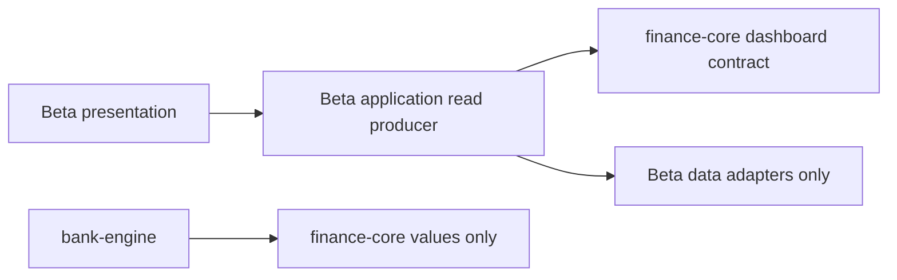

# M2.4 — Beta dashboard read boundary

Status: contract implementation for review. This does not implement M9 runtime,
replace production calculators, or declare M2/M9 complete. Work is confined to
`lab/finance-core`; no production database, schema, source, UI, or old code changes.

## Decision: one application-owned read model

`DashboardReader.read(DashboardQuery)` is the only read entry point. The query
requires environment, half-open instants, caller-selected zone, and display currency.
No bank zone mapping or device-zone fallback is introduced. The application
producer owns bounded batch reads, scoped historical evidence and financial
builders; the UI displays their results. `ReadRevision` carries a consistency
token and freshness timestamp. There is no write, raw SMS or bank-engine API.

| Layer | Allowed | Forbidden |
|---|---|---|
| finance-core dashboard | JDK/Kotlin, finance values/assets/posting facts | Android, Room, Compose, bank-engine, production imports |
| bank-engine | finance value package only | dashboard/posting/ownership decisions |
| Beta application producer (future M8/M9) | Beta stores, calculators, dashboard contract | production repositories; writes during a read |
| Beta presentation (future M9) | display resolved values and qualified identities | SMS scans, classification, sums, FX conversion, ID construction |

Existing `ModuleBoundaryTest` and `pure-jvm-boundaries.gradle.kts` enforce the
actual source/Gradle edges and dependency cycles. No new module/interface per
production class is added. Rows share `AssetId`, `DisplayPeriod`, `SignedAmount`
and the existing posting identity/revision/time/FX types.

## Production coverage inventory

Production sources below were read for semantics only. Contract values are
provided by future specialist builders; this PR contains no financial calculator.

| Existing production source | Contract coverage |
|---|---|
| `DashboardService` / `DashboardOverview` | one snapshot; selected period, accounts, cards, loans, commitments, analysis, transaction facts, read revision |
| `MonthlyFinancialSummary` / calculator | every money field through `SummaryMetric`, precomputed combined incoming/net cash flow; transaction/review/excluded-currency counts |
| `CurrentAccountSummary`, `AccountFlow`, `AccountsSummary`, `SpendingSplitSummary` | complete flow buckets on both per-account and precomputed `fleetFlow`, external/internal totals, signed remaining/cash position; portfolio totals; actual account spending and credit purchases remain separate metrics |
| `OwnedAccount`, `BankHierarchyOverview` | bank/environment-qualified registry identities, current/savings/wallet category, labels, card-to-account and card-to-facility links; suffix is display evidence only. Precomputed hierarchy display grouping still belongs to the future Beta application producer; no UI grouping/calculation migration is supplied here |
| `CreditCardDashboardRow`, `CreditFacilityOverview` | distinct calendar/salary/statement periods, available balance/as-of, primary/supplementary membership, one statement due/date/issue timestamp on the facility |
| `DebitCardOverview` | linked or unlinked debit, salary spending, label/network; no statement due field |
| `LoanOverview`, `LoanRepaymentAttribution` | loan identity/type, observed remaining/installment with timestamps, salary payment; already-resolved row loan attribution preserves FEE/financing semantics |
| `CommitmentsOverview` | individual recurring occurrences, paid/unpaid, expected date, exclusive user/facility/loan attribution; computed totals |
| `DashboardTransactionFacts`, involvement maps, `FinancialTransaction` | stored/effective type, original amount, card display suffix, account/card/debit/loan IDs, resolved owned source/destination direction and opaque category ID, FX and SAR equivalent excluding fee, separate international fee, evidence IDs and correction/interpretation revision |
| `DailySpendingTrend`, `DashboardSpendingTrends`, chart categories, merchant spending | date points, before-refund/refund/net values, precomputed average, overall/account/credit/debit/purchases aggregate scopes plus category/entity/window scopes and merchant values |

The summary keys are a finite vocabulary, not arbitrary UI strings. Complete key
sets prevent missing fields silently becoming zero. Null means unavailable; known
empty history uses explicit zero. Native asset amounts retain their currency;
each aggregate/flow/analysis/trend enforces its declared currency. Mixed-currency
or incomplete portfolio dues/loan balances stay null rather than being summed.
`SignedAmount` permits negative balances, remaining and refund-heavy spending;
it rejects excess precision without rounding. Core `Money` remains a non-negative
magnitude, and `AppliedFx` keeps its original full precision.

Credit cards have no duplicated due field: all members refer to their containing
facility. Debit has no statement fields. Unknown links remain null. Snapshot
validation rejects duplicate identities, cross-environment data, dangling owned
links, unresolved involvement, invalid query bounds and mismatched chart zones.
Summary values are independent of chart selection. Comparison trends may precede
the selected transaction window; their transaction IDs are provenance, not an
instruction for presentation to fetch history. Consumers must not mutate passed
collections; the eventual producer must freeze them for the snapshot lifetime.

Historical UNKNOWN types and empty evidence links remain representable without
inventing SMS references. Present evidence IDs must be nonblank. This read-only
permissiveness does not change `PostingGate` or the stricter `PostingCommand`:
unknown posting and missing posting evidence still cannot acquire authority.

## Verification and limits

`DashboardReadContractTest` exercises negative/refund-heavy amounts, explicit
zero vs unavailable, qualified identity collisions, shared facility dues, linked
and unlinked debit, distinct card windows, loan attribution, FX precision,
occurrences, query boundaries, references, currency guards and historical trend
scope. `LegacyDashboardReadFixtureTest` maps a frozen pure-data excerpt of
`active_m8_asof_fx.json` from main `ecdf761`: 2 USD rows, only the October 7 row
has an observed rate, spending gross 40 SAR, excluded-currency count 1. It proves
the contract can retain the reference output, **not** runtime calculator parity.
No existing golden output or hash is changed, and no production dependency is used.

Run `:lab:finance-core:test :lab:bank-engine:test`; Lab CI already owns these
tasks once. Main CI continues to own Android/Beta tests and emulator checks.

Still required: M8 persisted financial facts and calculators; Beta storage reader
with atomic consistency and collection freezing; scoped SQL evidence/query plans;
full corpus/golden projection parity; UI screenshots/interactions; long-history
p50/p95 and memory comparisons. M9 stays planned until those gates are met.
Production promotion, migration of real data and old-code deletion are deferred.
