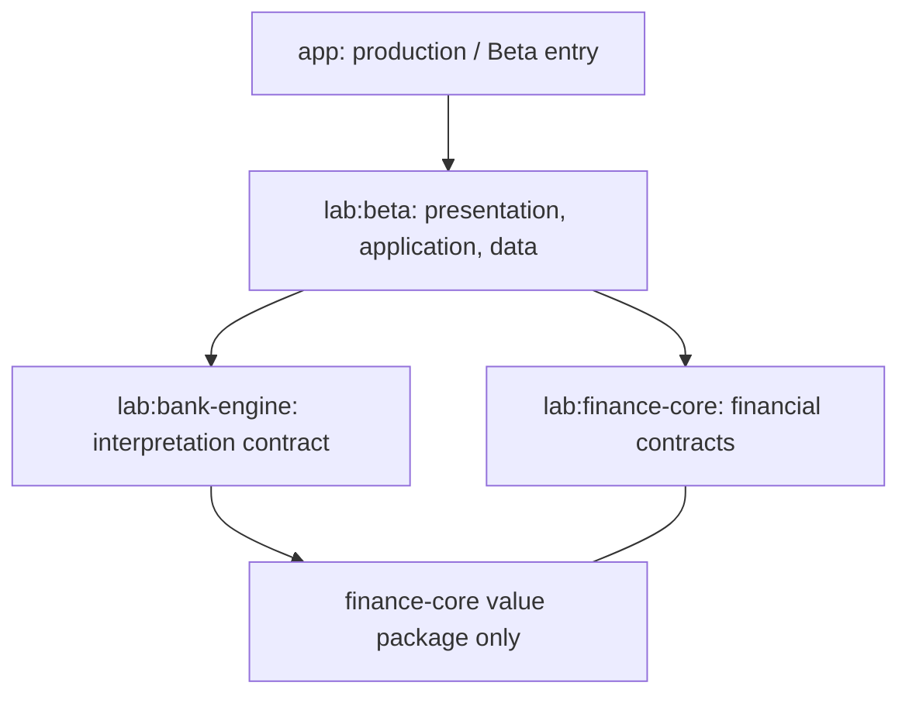

# M2 foundation — Beta domain boundaries

Status: first reviewable M2 foundation, not a completed milestone. This implements
the M2 module/contract boundaries from the Beta-First plan. No production source,
financial algorithm, Room schema, routing, or ledger write is replaced.

## Decision and ownership

| Owner | Public boundary | Permitted dependencies |
|---|---|---|
| `lab:finance-core` | values, owned assets, posting/review, dashboard read | Kotlin/JDK only |
| `lab:bank-engine` | facts, evidence, blockers, versions, bank catalog, interpreter | Kotlin/JDK + finance **value** package |
| `lab:beta` application | user bank selection; eventual orchestration/mapping | both cores; no production imports |
| `lab:beta` data | future persistence adapters | Android/Room and pure contracts |
| `lab:beta` presentation | display application results | no bank detection or financial classification |

Two modules protect the two business boundaries required by the plan. Value types
stay in finance-core instead of adding a third utility module. The bank engine
must not import financial assets, dashboard or posting rules. Existing `lab:engine`
and `lab:android` remain unchanged. Gradle graph tests reject a `lab -> app` edge
and dependency cycles; import tests protect pure cores and Beta isolation.

## Financial semantics retained

- Money retains production's SAR/USD/EUR/GBP, non-negative magnitudes, two-place
  HALF_EVEN factories. Direction/type express economic meaning. FX rates are
  separate positive BigDecimals and retain their full precision.
- Bank IDs are stable IDs, not display labels. Unknown routing has no durable
  bank identity. Asset IDs include environment, bank and registry ID. Last4 is
  evidence, never the primary key, even within one bank.
- Credit primary/supplementary roles remain explicit. Both may link to one
  facility; a facility owns statement due. Debit cards carry period spending,
  with no statement-due field. Unknown card links remain null; future data
  adapters validate parent kind and registry existence before posting.
- Facts preserve the fields from production `ParsedEvent` and
  `ParsedEventDetails`: source/destination/card references, bank network,
  purchase/card channel, confidence/status, receipt vs transaction time,
  biller/code, loan kind, salary wording, balances, due date and FX/fee evidence.
  Null facts mean absent, not zero. Facts never declare ownership or posting.
- Interpretation versions contain independent contract, engine and rule versions.
  Unsupported contract versions must be rejected by the future Beta mapper.
  Evidence offsets refer to the original message, not normalized comparison text.
- Sender collisions return every candidate regardless of catalog order. User
  bank selection is an import scope in Beta, not an input to routing decisions.
- PostingGate separates validation authority from unresolved ownership/matching
  blockers. Metadata-only correction cannot promote invalid parsing. Explicit
  financial confirmation does not bypass unresolved ownership. No new financial
  classifier or bank rule is implemented here.
- Posting keys survive reparses and include environment. Correction revision
  takes precedence over interpretation revision, so an old reparse cannot undo
  a newer manual decision. Equal revisions are retry no-ops only for identical
  payloads; the future atomic store must report conflicts otherwise. Database
  failure/retry and preserving corrections remain obligations of that adapter.
- A stored posting carries the resolved instant and zone. No handset-zone
  conversion or bank timezone map is introduced; the existing time policy must
  be ported and characterized before assembly is wired.

## Scope and acceptance evidence

The dashboard boundary now covers accounts/flows, debit and facility/card windows,
loans, commitments, full-period summary metrics, transaction facts/FX/provenance
and scoped trend/merchant outputs. See [M2.4 coverage and limits](M2_DASHBOARD_READ_CONTRACT.md).
Actual builders, persistence reads and runtime parity are still outstanding;
this contract is not a replacement for DashboardOverview.

Pure JVM tests cover monetary semantics, bank/same-bank suffix collisions,
supplementary facilities, correction authority, review gating, revision ordering,
FX precision, transaction zones, read-only snapshot scope, catalog collisions,
original evidence slices, unsupported versions, transfer facts and an executable
synthetic adapter example. Boundary tests inspect the actual Gradle graph and
source imports. They do not prove production/legacy adapter parity.

Run `./gradlew :lab:finance-core:test :lab:bank-engine:test`; Lab CI owns these
tasks once, alongside the existing JVM engine tests. Existing Android/Beta unit
tests remain in the main CI suite.

## Still required before M2 closure / runtime adoption

1. Real legacy/shadow adapters with corpus-based parity, including pending or
   invalid interpretations and manual correction precedence. The synthetic test
   proves only the API compiles and carries representative facts.
2. Beta mapping from versioned interpretation to ownership/classification with
   exhaustive status/blocker handling, plus runtime adoption of the dashboard read shape.
3. Durable asset/selection/posting adapters, atomic revision/payload conflict
   tests and retry acceptance (storage belongs to M3/M8).
4. Integration acceptance demonstrating return to production leaves its state
   unchanged; existing M0 isolation tests continue to run.
5. CI evidence and review before marking the Notion milestone Verified/Completed.

There is no production wiring and no old-code deletion in this change.
