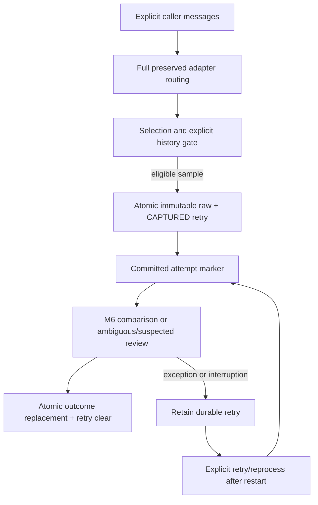

# M7 foundation: durable explicit Beta evidence

This is an independently reviewable M7.1–M7.3 foundation, not a completed M7.
There is no Beta inbox permission/UI, scanner, live receiver, WorkManager worker,
financial classification, ownership inference, reconciliation or ledger posting.
The production SMS path/database and old code are untouched. Caller-supplied
messages enter the Beta application API explicitly and feed the existing M6
comparison seam only; that candidate engine is not financially authoritative.

## Boundary and outcome semantics

`BetaContainer.importEvidence(EvidenceRequest, List<EvidenceMessage>)` accepts an
explicit source namespace/provider ID, sender/body, immutable receipt instant
and mandatory receipt-time provenance. Historical requests must name banks;
sample requests cannot pretend to be historical. There is no device inbox read
inside this API and no user-visible import button claiming otherwise.

The full preserved lab adapter registry routes before applying selection scope.
Its normalized exact senders, ambiguous matches and suspected-bank results are
retained. No bank selection filters the registry or resolves a collision:

| Route / new-capture scope | Result |
|---|---|
| Matched, enabled, within explicit requested history if applicable | Capture, then compare |
| Matched but disabled/unselected | `NotCaptured(NOT_ENABLED)` |
| Matched outside requested history | `NotCaptured(OUTSIDE_REQUESTED_HISTORY)` |
| Ambiguous with at least one enabled candidate in requested scope | Capture **all candidates**, persist REVIEW, do not interpret |
| Ambiguous with no enabled/requested intersection | Explicit scope rejection, no capture |
| Suspected explicit sample | Capture REVIEW without assigning a bank or interpreting |
| Suspected restricted history | `NotCaptured(UNPROVEN_HISTORY_SCOPE)`; no proved bank scope |
| Unrecognized | `NotCaptured(UNRECOGNIZED)` |

These rejection results do not claim that interpretation succeeded. They create
no raw row. The caller retains its supplied input; there is no automatic source
deletion. An already captured identity is checked before current selection scope;
disabling a bank never deletes history. Explicit `reprocessEvidence(id)` and
`retryEvidence(limit)` can compare saved evidence while disabled.

`Stored` means durable Beta state, including incomplete retry state. Inspect
`processingState` before treating a comparison as complete; RETRY always takes
precedence over a retained prior disposition. A non-null retry always
means unfinished work even if a previous comparison is still visible. A completed
comparison is either REVIEW or COMPARISON_ONLY, never financial success. Status,
blocker, bank or fact differences produce review codes; the outcome does not
claim reconciled or posted transactions. Live/historical ledger equivalence and
the production reconciliation completion policy cannot be demonstrated yet.

## Beta schema 3 → 4 and persistence

Four Beta-only tables are added with an auto-migration. Existing assets, aliases,
bank selection and shell markers are retained. The production schema is unchanged.

| Table | Responsibility |
|---|---|
| `beta_raw_evidence` | Immutable namespace/provider identity, origin, sender/body, received instant/source, injected capture time and original full route/selection/history snapshots |
| `beta_evidence_outcome` | Latest route, closed review reason codes, versioned local baseline/candidate interpretation archives, attempt count and injected completion time |
| `beta_evidence_retry` | Durable stage, attempt count, fixed safe code and injected time |
| `beta_evidence_decision` | Independent revisioned KEEP_FOR_REVIEW / ACKNOWLEDGE_COMPARISON decision; no bank or financial override |

Child rows have raw-evidence foreign keys. Raw has no update DAO; an initial
transaction inserts raw and retry together or neither. SHA-256 keys hash
length-prefixed namespace/provider ID, not SMS contents, so separate identical
bank notices remain separate. The namespace/provider pair is also uniquely
indexed. Reimport with the same identity and payload returns existing state;
changed sender/body/time/time-source/origin conflicts without overwriting raw,
outcome, retry or manual decision. Capture-time/selection changes cannot rewrite
the original provenance. A completed duplicate is not compared again; explicit
reparse is the separate operation for new rule versions.

Beginning an attempt commits a retry marker before derivation. Outcome replacement
and retry clearing share one transaction. SQL errors leave the earlier outcome
and retry intact. Engine exceptions store fixed codes only, never exception text.
Cancellation propagates and leaves the precommitted marker. If cancellation comes
after a committed outcome, the committed result survives and duplicate import
does not run again. Stored pending IDs allow an explicit restart/retry after
reopening the database. No fake ledger reconciliation per row exists.

Manual decisions use expected-revision comparison inside a transaction; stale
updates fail. Reparse/engine failures never replace them. These acknowledgements
are not parsing or financial overrides. Unsupported archived contracts fail into
retry, not a guessed mapping. Selection and request collections are copied before
asynchronous processing. Container methods use the existing maintenance lock and
create stores/workflows from the current database for each operation, so backup,
restore and reset cannot leave a cached store pointing at a closed database.

## Privacy and versioned archives

Raw text and complete facts/confidence/diagnostic/evidence/version information
remain inside Beta's local database/backup only. Archives are versioned JSON;
Money strings and FX decimal precision are preserved, null remains null, evidence
offsets remain original-message offsets. The archive is retained for future review
without reparsing; this increment does not supply a public archive decoder/view.
No body goes into logs, work data, reports or public summaries. Sensitive classes
override `toString` with redacted output. Public reason codes use a closed safe
format; arbitrary exception/diagnostic text is not a summary reason.

## Evidence and remaining gates

Tests cover raw-before-derivation, exact identity conflicts, identical-body twins,
full-catalog ambiguity, suspected/unknown routes, explicit history/selection scope,
engine exception, cancellation, capture/outcome SQL rollback, restart at capture
and after comparison, durable manual revisions, reparse while disabled, backup/
restore/reset using one container, and production canaries. The archive test checks
every `Facts` field by reflection so a future unarchived field fails CI, plus full
confidence/diagnostics, nulls, versions, evidence ranges and decimal precision.
Restart tests here close/reopen the Robolectric database or inject cancellation;
they do not kill an Android OS process. Actual Beta-specific OS process-kill
acceptance remains outstanding; existing production lifecycle CI does not prove it.
Device migration tests are provided for 3→4 preservation and 1→4 upgrade, then a
real local comparison and backup/restore. Local JDK17/Gradle8.8 validation passed
50 Beta unit tests (21 new), test APK assembly and lint. Device tests compiled;
their emulator execution remains a CI gate. The failure matrix caught and fixed
retry writes using delete-and-replace semantics: retry now uses Room `@Upsert`,
so updating a marker cannot delete it during failure handling. Existing
UI/isolation tests continue to run.

Still required before M7 closure: explicit inbox import UI/permission/scanner,
batch performance evidence, durable financial adapters and authoritative M8
results, full live/historical/reparse ledger parity, and any later live Beta intake
only after isolation acceptance. No legacy deletion or promotion is authorized by
this foundation. CI/device results must be recorded before merge.
